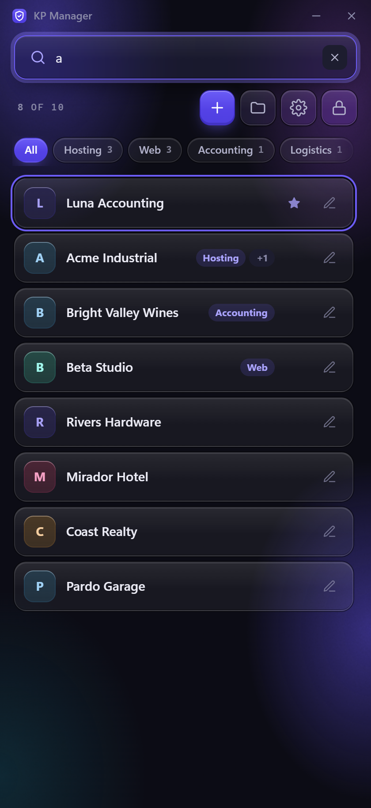
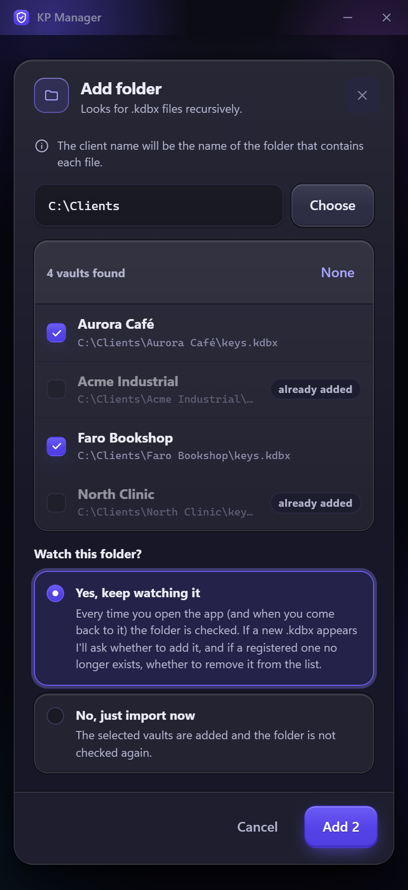
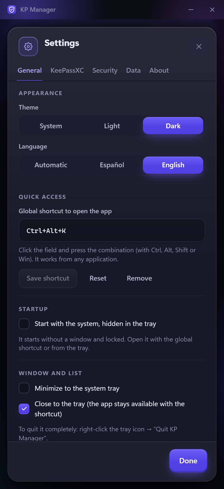

<div align="center">

[Español](README.md) · **English**


# KP Manager

**All your KeePass vaults, one click away.**
A fast, secure launcher for anyone who keeps one `.kdbx` per client.

[Download](https://github.com/fmartineze/kpmanager/releases/latest) · [How to use](#how-to-use) · [Security](#security)

</div>

<p align="center">
  
  
  
</p>

<p align="center"><sub>Screenshots use fictional data.</sub></p>

---

## What is it?

If you work with many clients and keep each one's credentials in its own KeePass database, opening them is a constant detour: find the folder, locate the file, open KeePassXC, pick the file, type the password and point to the keyfile.

**KP Manager** gathers all those vaults into a single list. Search for the client, press **Enter**, and KeePassXC opens with the vault already unlocked.

> KP Manager **does not store your website passwords**: that remains KeePassXC's job. It only remembers where each vault is and, if you want, the password and keyfile used to open it, and it stores all of that encrypted.

## Features

- 🔎 **Instant search** as you type, ignoring case and accents.
- ⌨️ **Keyboard-first:** type, ↑↓ arrows and **Enter** to open.
- ⭐ **Favorites and recents:** pin your most-used clients on top; the rest is sorted by last use (or alphabetically).
- 📁 **Import whole folders:** the client takes the name of the folder that contains the `.kdbx`. No duplicates.
- 🏷️ **Tags** ("Hosting", "Accounting"…) to group clients and filter the list with one click; they are searchable too.
- 👁️ **Watched folders:** the app tells you when a new vault appears or one disappears, and asks what to do.
- 🔐 **Encrypted credentials** with your own master password, and unlock with **Windows Hello** (fingerprint, face or PIN).
- 🔑 **Default keyfile** so you don't have to repeat it on every vault.
- 🪟 **Always at hand:** it lives in the system tray and opens from any application with a configurable **global shortcut** (`Ctrl + Alt + K` by default).
- 🔔 **New-version notices** with the download link; you can ignore a version or turn the check off.
- 🚀 **Start with Windows** (optional): it starts hidden in the tray and locked, ready for the shortcut.
- 💾 **Export and import** the whole configuration in an encrypted file, for backups or moving to another computer.
- 🌗 **Light, dark or system theme**, your choice.
- 🌍 **Spanish and English.** It picks one automatically from the Windows language (Spanish if it is Spanish, English otherwise) and you can fix it in Settings.

## Installation

**Requirements:** Windows 10 or 11 and [KeePassXC](https://keepassxc.org/download/) installed.

1. Go to the [**Releases**](https://github.com/fmartineze/kpmanager/releases/latest) page.
2. Download the installer (`.exe` or `.msi`) and run it.
3. Open **KP Manager** from the Start menu.

The `.exe` installer is shown in **Spanish** if Windows is in Spanish and in **English** otherwise. The `.msi` is published in two versions, `es-ES` and `en-US`: pick the one in your language.

> **Windows SmartScreen warning.** The installer is not digitally signed yet, so Windows may show "Windows protected your PC". Click **More info → Run anyway**. If you'd rather not trust the binary, you can [build it yourself](#build-from-source).

Linux and macOS are not available yet; the code is prepared for them and they will come in a future version.

## How to use

### First run

1. Create a **master password**. It encrypts the settings and any credentials you save. **It cannot be recovered**: if you lose it, you will have to start from scratch (your `.kdbx` files are not affected).
2. KP Manager detects KeePassXC by itself. If it is in an unusual location, set it in **Settings**.

### Adding your vaults

- **By hand:** the **＋** button → choose the `.kdbx`, and optionally the password and keyfile.
- **A whole folder:** the **Folders** button → **Add folder**. You'll see the `.kdbx` files found; tick the ones you want and they are added using their folder name as the client. Ones you already had show as "already added".

### Opening a vault

Type part of the client's name and press **Enter** (or click its row). KeePassXC opens with the vault ready. You'll see "Opening…" and then "Opened".

| Shortcut | Action |
| --- | --- |
| `Ctrl + F` | Go to the search box |
| `↑` `↓` | Move through the list |
| `Enter` | Open the highlighted vault |
| `Esc` | Clear the search |
| `Ctrl + Alt + K` | Open KP Manager from anywhere *(configurable)* |

### Tags

In each client's form (pencil) you can add **tags**: type and press **Enter** or comma (up to 8 per client; they autocomplete from the ones you already use). They show up:

- as a **filter bar** under the search box, with how many clients each one has: one click filters, another removes the filter;
- as a badge on the row (the first tag and a "+N" if there are more);
- in **search**: typing "acc" also finds clients tagged "Accounting".

### Watched folders

When you add a folder, the app asks whether you want to **keep watching it**. If you say yes, every time you open the app (and when you come back to it) it checks the folder and tells you about:

- **New vaults:** it asks whether to add them. The ones you dismiss are not suggested again.
- **Vaults that no longer exist:** it asks whether to remove them from the list.

From **Folders** you can see each folder's status, **rescan it completely** (including dismissed vaults), stop watching it, or suggest the dismissed ones again.

### Windows Hello

In **Settings → Security → Windows Hello**, confirm your master password and enable it. From then on the app unlocks with your fingerprint, face or PIN. If it fails or you cancel it, you can always use the master password. If you change the master password, Hello is disabled and you have to enable it again.

### Backup and moving to another computer

In **Settings → Data → Backup**:

- **Export…** saves your clients, saved credentials, watched folders and preferences in a `.kpm` file. It is **encrypted with your current master password**; nothing leaves in clear text.
- **Import…** asks for the file and the master password it was exported with (which may differ from this computer's). There are two modes:
  - **Merge:** adds the vaults and folders you're missing and leaves what you already have alone.
  - **Replace all:** replaces your data and preferences with the file's. This computer's master password does not change.

Paths are imported as they are: if the `.kdbx` files live at a different path on the new computer, the watched folders will tell you which ones they can't find so you can remove them or add them again.

### Updates

When you open the app (and every 24 hours if you leave it open) KP Manager checks GitHub for a newer version. If there is one, it tells you with the **link to the download page**, and you can choose:

- **View and download:** opens the version's page in your browser.
- **Later:** it won't tell you about that version again until you reopen the app.
- **Ignore this version:** it won't tell you about that version again, but it will about a later one.

In **Settings → About → Updates** you can **check now**, **be notified again** about the version you ignored, or **turn the check off** completely. The app does not update itself: it only lets you know.

### Theme and language

In **Settings → General → Appearance** you choose the theme (**System**, **Light** or **Dark**) and the language (**Automatic**, **Español** or **English**). The change applies instantly. With "Automatic", the app uses Spanish if Windows is in Spanish and English otherwise.

### System tray

By default, **closing the window does not quit the app**: it stays in the tray and comes back with the global shortcut. To quit it completely, **right-click the tray icon → Quit KP Manager**.

In **Settings → General → Window and list** you can change this behavior and also minimize to the tray. In **Settings → Security → Locking** you can make **the app lock when it is hidden**; it also locks itself after 5 minutes of inactivity.

### Start with Windows

In **Settings → General → Startup** you can make KP Manager start with the system. It does so **without a window and locked**, in the tray: open it with the global shortcut (or the icon) and unlock with Windows Hello. If you uninstall with the `.exe` installer, this startup entry is removed automatically; if you installed with the `.msi`, turn the option off before uninstalling.

## Security

- **Encryption:** your master password is turned into a key with **Argon2id** and everything is encrypted with **XChaCha20-Poly1305**. Nothing is stored in clear text.
- **Passwords sent to KeePassXC:** they travel through the process's standard input, **never** on the command line, where any program could see them.
- **Windows Hello:** the master password is stored encrypted with a key that only Windows hands over after you authenticate with Hello. Copying the app's files is not enough to open it.
- **Your `.kdbx` files are not touched:** KP Manager does not read or modify them; it only launches them in KeePassXC.
- **No accounts and no telemetry.** The only internet connection is an anonymous request to GitHub to see whether a new version exists; it sends none of your data and can be turned off in **Settings → About → Updates**.

Where it stores its data (in `%APPDATA%\kpmanager\KPManager\config`):

| File | Contents |
| --- | --- |
| `vaults.enc` | Clients, paths, saved credentials and watched folders. **Encrypted.** |
| `hello.bin` | Master password protected by Windows Hello. **Encrypted.** |
| `prefs.json` | Theme, language, shortcut, sort order and window options. No sensitive data. |

> 💾 Back up `vaults.enc` if you don't want to lose your saved credentials. To start from scratch, use **Settings → Data → Erase all data** (it asks for confirmation and does not touch your `.kdbx` files). If you forgot the master password and can't get into Settings, close the app and delete that folder.

## FAQ

**Where are my KeePass passwords stored?**
In your `.kdbx` files, as always. KP Manager can only remember each vault's *opening* password if you give it one.

**Do I have to save each vault's password in the app?**
No. It is optional. Without it, KeePassXC opens and asks for it as usual.

**The global shortcut doesn't work.**
If the combination is taken by another application, KP Manager tells you at startup and also in **Settings → General → Quick access**; pick a different one. Other possible causes:

- **A window running as administrator is in the foreground.** Windows does not deliver a normal application's global shortcuts while focus is on an elevated window (for example, an administrator console). Switch focus to another window and try again.
- **Keyboards with an AltGr key.** On some layouts `Ctrl + Alt` is equivalent to `AltGr` and can clash with special characters. Try another combination, such as `Ctrl + Shift + K`.

**Windows Hello doesn't show up in Settings.**
Your computer doesn't have Hello set up or doesn't support it. Set it up in *Windows Settings → Accounts → Sign-in options*.

**Does it work with classic KeePass or KeePass2Android?**
No, only with [KeePassXC](https://keepassxc.org/).

## Build from source

You need [Rust](https://rustup.rs/) (MSVC toolchain on Windows), [Node.js](https://nodejs.org/) 20 or later and the [Tauri prerequisites](https://tauri.app/start/prerequisites/).

```bash
npm install
npm run tauri dev      # run in development
npm run tauri build    # build the installer
cd src-tauri && cargo test   # backend tests
```

Built with [Tauri 2](https://tauri.app/), Rust and React.

## License

[MIT](LICENSE)
