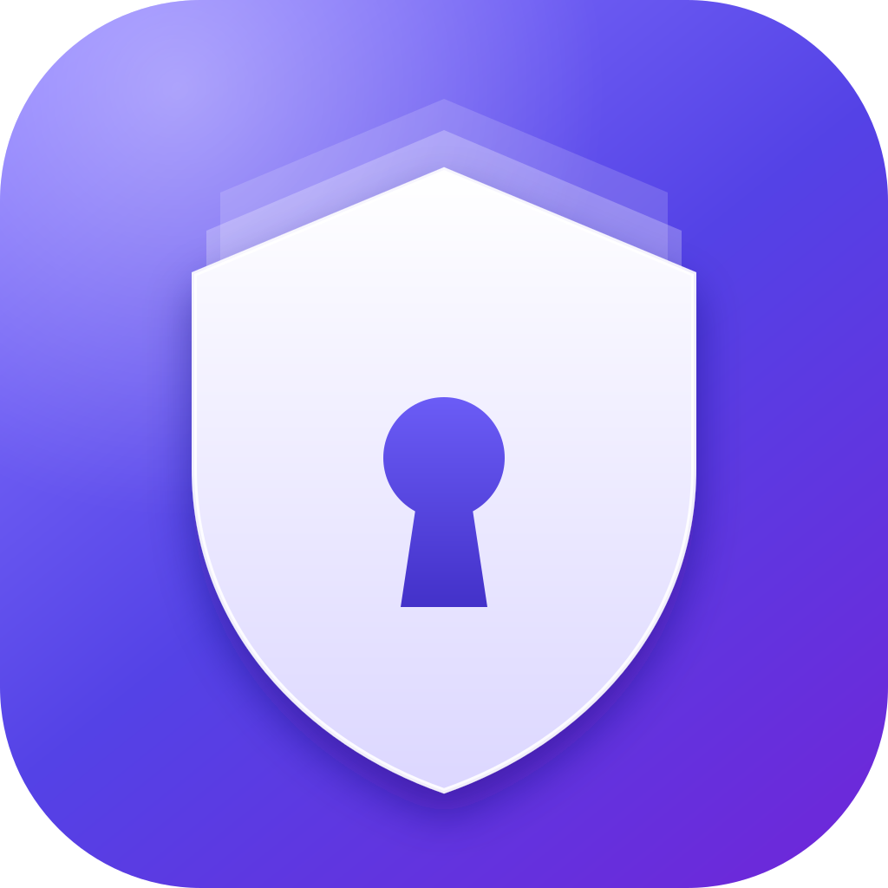
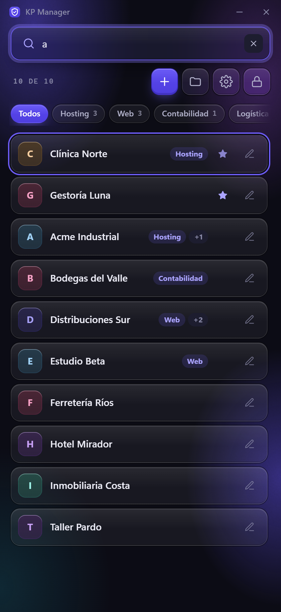
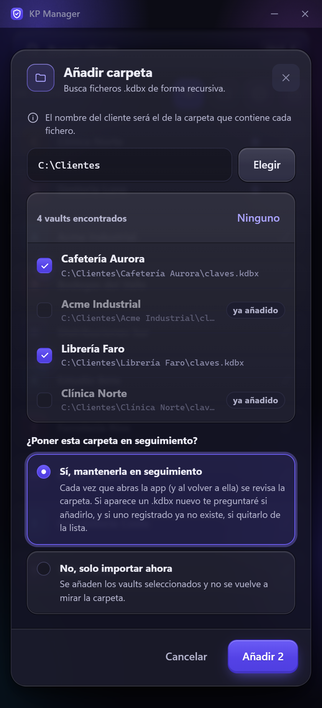
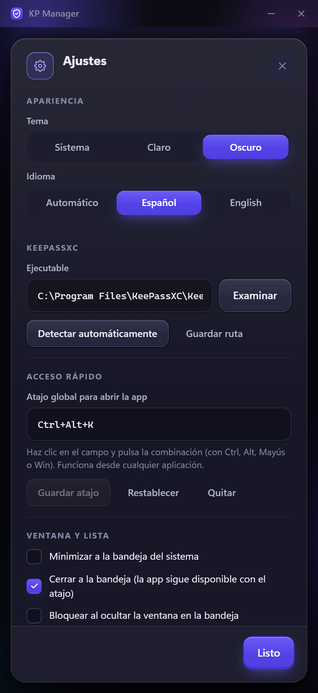

<div align="center">



# KP Manager

**Todos tus vaults de KeePass, a un clic.**
Un lanzador rápido y seguro para quien mantiene un `.kdbx` por cliente.

[Descargar](https://github.com/fmartineze/kpmanager/releases/latest) · [Cómo se usa](#cómo-se-usa) · [Seguridad](#seguridad)

</div>

<p align="center">
  
  
  
</p>

<p align="center"><sub>Capturas con datos ficticios.</sub></p>

---

## ¿Qué es?

Si trabajas con muchos clientes y guardas las credenciales de cada uno en su propia base de datos de KeePass, abrirlas es un rodeo constante: buscar la carpeta, localizar el fichero, abrir KeePassXC, elegir el fichero, escribir la contraseña y apuntar el keyfile.

**KP Manager** reúne todos esos vaults en una sola lista. Buscas el cliente, pulsas **Enter** y KeePassXC se abre con el vault ya desbloqueado.

> KP Manager **no guarda las contraseñas de tus sitios web**: eso sigue siendo cosa de KeePassXC. Solo recuerda dónde está cada vault y, si quieres, con qué contraseña y keyfile se abre, y lo guarda todo cifrado.

## Características

- 🔎 **Búsqueda instantánea** mientras escribes, sin distinguir mayúsculas ni acentos.
- ⌨️ **Todo con teclado:** escribe, flechas ↑↓ y **Enter** para abrir.
- ⭐ **Favoritos y recientes:** fija arriba los clientes que más usas; el resto se ordena por último uso (o alfabéticamente).
- 📁 **Importar carpetas enteras:** el cliente toma el nombre de la carpeta que contiene el `.kdbx`. Sin duplicados.
- 👁️ **Carpetas en seguimiento:** la app avisa cuando aparece un vault nuevo o desaparece uno, y te pregunta qué hacer.
- 🔐 **Credenciales cifradas** con una contraseña maestra propia, y desbloqueo con **Windows Hello** (huella, rostro o PIN).
- 🔑 **Keyfile predeterminada** para no repetirla en cada vault.
- 🪟 **Siempre a mano:** vive en la bandeja del sistema y se abre desde cualquier aplicación con un **atajo global** configurable (por defecto `Ctrl + Alt + K`).
- 💾 **Exportar e importar** toda la configuración en un fichero cifrado, para hacer copias o cambiar de equipo.
- 🌗 **Tema claro, oscuro o el del sistema**, a tu elección.
- 🌍 **Español e inglés.** Se elige solo según el idioma de Windows (español si lo es, inglés en cualquier otro caso) y se puede fijar en Ajustes.

## Instalación

**Requisitos:** Windows 10 u 11 y [KeePassXC](https://keepassxc.org/download/) instalado.

1. Ve a la página de [**Releases**](https://github.com/fmartineze/kpmanager/releases/latest).
2. Descarga el instalador (`.exe` o `.msi`) y ejecútalo.
3. Abre **KP Manager** desde el menú Inicio.

> **Aviso de Windows SmartScreen.** El instalador todavía no está firmado digitalmente, así que Windows puede mostrar «Windows protegió su PC». Pulsa **Más información → Ejecutar de todas formas**. Si prefieres no fiarte del binario, puedes [compilarlo tú mismo](#compilar-desde-el-código).

Linux y macOS no están disponibles todavía; el código está preparado para ello y llegarán en una versión futura.

## Cómo se usa

### Primer arranque

1. Crea una **contraseña maestra**. Cifra la configuración y las credenciales que guardes. **No se puede recuperar**: si la pierdes, tendrás que empezar de cero (tus ficheros `.kdbx` no se ven afectados).
2. KP Manager detecta KeePassXC solo. Si lo tienes en una ruta poco habitual, indícala en **Ajustes**.

### Añadir tus vaults

- **A mano:** botón **＋** → elige el `.kdbx`, y opcionalmente la contraseña y el keyfile.
- **Una carpeta entera:** botón **Carpetas** → **Añadir carpeta**. Verás los `.kdbx` encontrados, marcas los que quieras y se dan de alta con el nombre de su carpeta como cliente. Los que ya tenías aparecen como «ya añadido».

### Abrir un vault

Escribe parte del nombre del cliente y pulsa **Enter** (o haz clic en su fila). KeePassXC se abre con el vault listo. Verás «Abriendo…» y después «Abierto».

| Atajo | Acción |
| --- | --- |
| `Ctrl + F` | Ir al buscador |
| `↑` `↓` | Moverse por la lista |
| `Enter` | Abrir el vault resaltado |
| `Esc` | Limpiar la búsqueda |
| `Ctrl + Alt + K` | Abrir KP Manager desde cualquier sitio *(configurable)* |

### Carpetas en seguimiento

Al añadir una carpeta, la app te pregunta si quieres **mantenerla en seguimiento**. Si dices que sí, cada vez que abras la app (y al volver a ella) revisa la carpeta y te avisa de:

- **Vaults nuevos:** te pregunta si añadirlos. Los que descartes no se vuelven a proponer.
- **Vaults que ya no existen:** te pregunta si quitarlos de la lista.

Desde **Carpetas** puedes ver el estado de cada una, **re-escanearla por completo** (incluidos los descartados), dejar de vigilarla o volver a proponer lo descartado.

### Windows Hello

En **Ajustes → Windows Hello**, confirma tu contraseña maestra y actívalo. A partir de ahí la app se desbloquea con tu huella, rostro o PIN. Si falla o lo cancelas, siempre puedes usar la contraseña maestra. Si cambias la contraseña maestra, Hello se desactiva y hay que volver a activarlo.

### Copia de seguridad y cambio de equipo

En **Ajustes → Copia de seguridad**:

- **Exportar…** guarda en un fichero `.kpm` tus clientes, las credenciales guardadas, las carpetas en seguimiento y las preferencias. Va **cifrado con tu contraseña maestra actual**; nada sale en claro.
- **Importar…** pide el fichero y la contraseña maestra con la que se exportó (puede ser distinta de la de este equipo). Hay dos modos:
  - **Combinar:** añade los vaults y carpetas que te faltan y no toca lo que ya tienes.
  - **Reemplazar todo:** sustituye tus datos y preferencias por los del fichero. Tu contraseña maestra de este equipo no cambia.

Las rutas se importan tal cual: si los `.kdbx` están en otra ruta en el equipo nuevo, las carpetas en seguimiento te avisarán de los que no encuentra para que los quites o los vuelvas a añadir.

### Tema e idioma

En **Ajustes → Apariencia** eliges el tema (**Sistema**, **Claro** u **Oscuro**) y el idioma (**Automático**, **Español** o **English**). El cambio se aplica al instante. Con «Automático», la app usa español si Windows está en español y inglés en cualquier otro caso.

### Bandeja del sistema

Por defecto, **cerrar la ventana no cierra la app**: se queda en la bandeja y reaparece con el atajo global. Para cerrarla del todo, **clic derecho en el icono de la bandeja → Cerrar KP Manager**.

En **Ajustes → Ventana y lista** puedes cambiar este comportamiento, minimizar también a la bandeja, y **bloquear la app automáticamente al ocultarla**. Además se bloquea sola tras 5 minutos sin actividad.

## Seguridad

- **Cifrado:** tu contraseña maestra se convierte en una clave con **Argon2id** y todo se cifra con **XChaCha20-Poly1305**. Nada se guarda en texto claro.
- **Contraseñas hacia KeePassXC:** viajan por la entrada estándar del proceso, **nunca** en la línea de comandos, donde cualquier programa podría verlas.
- **Windows Hello:** la contraseña maestra se guarda cifrada con una clave que solo Windows entrega tras autenticarte con Hello. Copiar los ficheros de la app no sirve para abrirla.
- **Tus `.kdbx` no se tocan:** KP Manager no los lee ni los modifica; solo los lanza en KeePassXC.
- **Local y sin red:** no hay cuentas, nube ni telemetría.

Dónde guarda sus datos (en `%APPDATA%\kpmanager\KPManager\config`):

| Fichero | Contenido |
| --- | --- |
| `vaults.enc` | Clientes, rutas, credenciales guardadas y carpetas en seguimiento. **Cifrado.** |
| `hello.bin` | Contraseña maestra protegida por Windows Hello. **Cifrado.** |
| `prefs.json` | Tema, idioma, atajo, orden y opciones de ventana. Sin datos sensibles. |

> 💾 Haz copia de seguridad de `vaults.enc` si no quieres perder tus credenciales guardadas. Para empezar de cero, usa **Ajustes → Datos → Borrar todos los datos** (pide confirmación y no toca tus `.kdbx`). Si has olvidado la contraseña maestra y no puedes entrar a Ajustes, cierra la app y borra esa carpeta.

## Preguntas frecuentes

**¿Dónde se guardan mis contraseñas de KeePass?**
En tus ficheros `.kdbx`, como siempre. KP Manager solo puede recordar la contraseña *de apertura* de cada vault si tú se la das.

**¿Tengo que guardar la contraseña de cada vault en la app?**
No. Es opcional. Sin ella, KeePassXC se abre y te la pide como siempre.

**El atajo global no funciona.**
Si la combinación está ocupada por otra aplicación, KP Manager te lo avisa al arrancar y también en **Ajustes → Acceso rápido**; elige otra distinta. Otras causas posibles:

- **Una ventana ejecutada como administrador en primer plano.** Windows no entrega los atajos globales de una aplicación normal mientras tienes el foco en una ventana con privilegios elevados (por ejemplo, una consola de administrador). Cambia el foco a otra ventana y vuelve a probar.
- **Teclados con tecla AltGr.** En algunas distribuciones, `Ctrl + Alt` equivale a `AltGr` y puede chocar con caracteres especiales. Prueba con otra combinación, como `Ctrl + Mayús + K`.

**Windows Hello no aparece en Ajustes.**
Tu equipo no tiene Hello configurado o no es compatible. Configúralo en *Configuración de Windows → Cuentas → Opciones de inicio de sesión*.

**¿Funciona con KeePass clásico o KeePass2Android?**
No, solo con [KeePassXC](https://keepassxc.org/).

## Compilar desde el código

Necesitas [Rust](https://rustup.rs/) (toolchain MSVC en Windows), [Node.js](https://nodejs.org/) 20 o superior y las [dependencias de Tauri](https://tauri.app/start/prerequisites/).

```bash
npm install
npm run tauri dev      # ejecutar en desarrollo
npm run tauri build    # generar el instalador
cd src-tauri && cargo test   # pruebas del backend
```

Hecho con [Tauri 2](https://tauri.app/), Rust y React.

## Licencia

[MIT](LICENSE)
