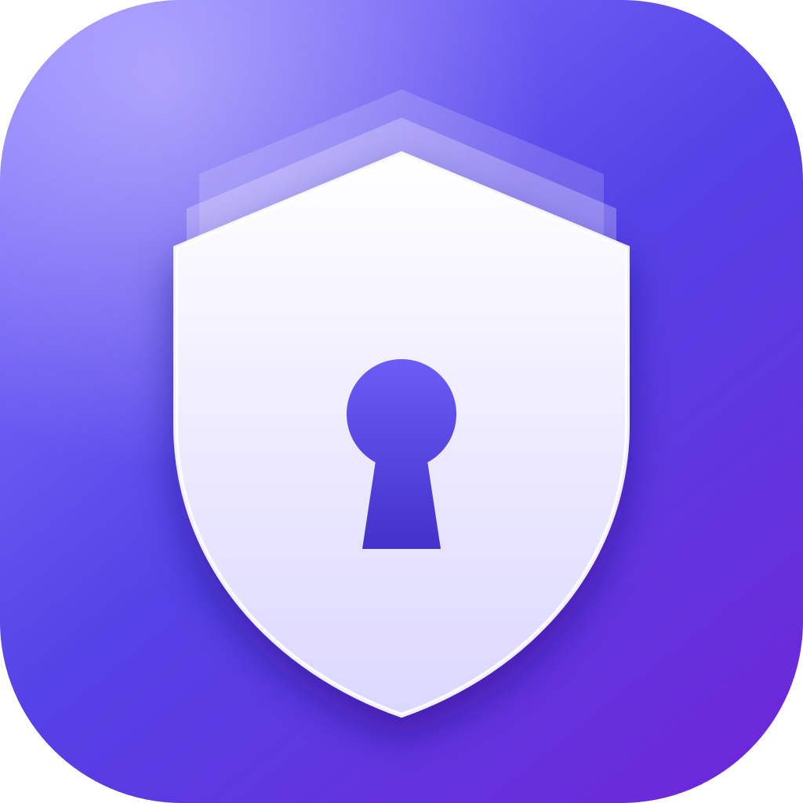
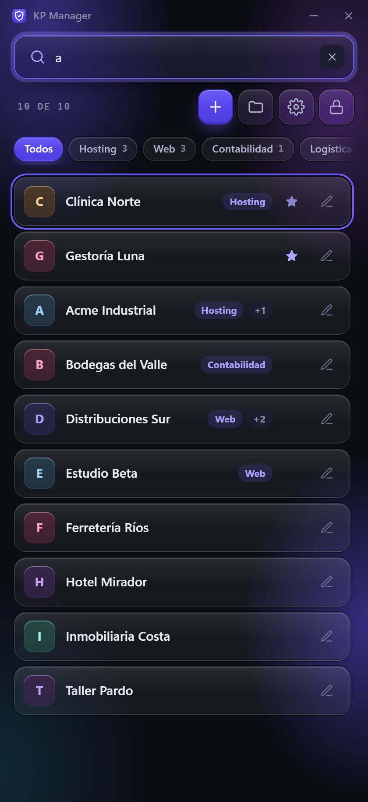
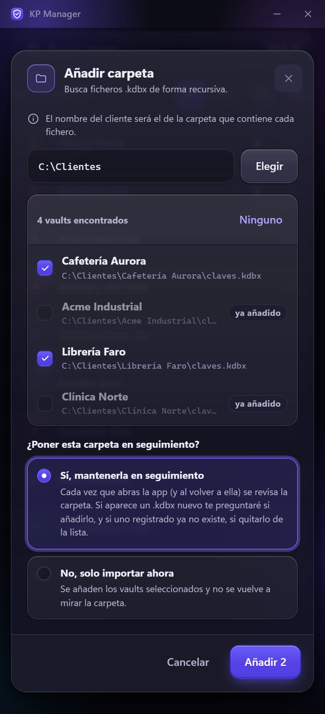
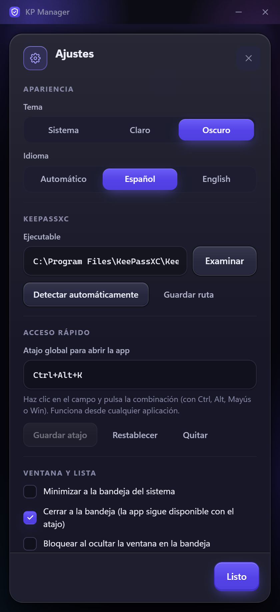

<div align="center">

**Español** · [English](README.en.md)



# KP Manager

**Todos tus vaults de KeePass, a un clic.**
Un lanzador rápido y seguro para quien mantiene un `.kdbx` por cliente.

[Descargar](https://github.com/fmartineze/kpmanager/releases/latest) · [Cómo se usa](#cómo-se-usa) · [Seguridad](#seguridad)

</div>

<p align="center">
  
  
  
</p>

<p align="center"><sub>Capturas con datos ficticios.</sub></p>

---

## ¿Qué es?

Si trabajas con muchos clientes y guardas las credenciales de cada uno en su propia base de datos de KeePass, abrirlas es un rodeo constante: buscar la carpeta, localizar el fichero, abrir KeePassXC, elegir el fichero, escribir la contraseña y apuntar el keyfile.

**KP Manager** reúne todos esos vaults en una sola lista. Buscas el cliente, pulsas **Enter** y recorres su vault desde la propia app (o **Mayús + Enter** para abrirlo en KeePassXC, ya desbloqueado).

> KP Manager **no guarda las contraseñas de tus sitios web**: siguen en tus `.kdbx`. Solo recuerda dónde está cada vault y, si quieres, con qué contraseña y keyfile se abre, y lo guarda todo cifrado. Al navegar un vault lo lee en **solo lectura** y en memoria; no escribe nunca en el fichero.

## Características

- 🔎 **Búsqueda instantánea** mientras escribes, sin distinguir mayúsculas ni acentos.
- ⌨️ **Todo con teclado:** escribe, flechas ↑↓ y **Enter** para abrir.
- 🗂️ **Navega el vault sin abrir KeePassXC:** grupos, entradas con sus iconos, búsqueda, copiar usuario/contraseña/código TOTP, notas en **Markdown** y descarga de **adjuntos**. Solo lectura.
- 🖥️ **SSH y Escritorio remoto con una tecla** desde la dirección de una entrada (consola o PuTTY), con puertos opcionales en campos personalizados.
- 📤 **Informe para compartir:** copia en texto las credenciales de una entrada, o de las que elijas de una carpeta, para pegarlas en una herramienta de compartir secretos con enlaces que caducan (Password Pusher y similares). Con avisos de seguridad; sin pasar por el historial de Windows y con borrado automático del portapapeles.
- ⭐ **Favoritos y recientes:** fija arriba los clientes que más usas; el resto se ordena por último uso (o alfabéticamente).
- 📁 **Importar carpetas enteras:** el cliente toma el nombre de la carpeta que contiene el `.kdbx`. Sin duplicados.
- 🏷️ **Etiquetas** («Hosting», «Contabilidad»…) para agrupar clientes y filtrar la lista con un clic; también se buscan.
- 👁️ **Carpetas en seguimiento:** la app avisa cuando aparece un vault nuevo o desaparece uno, y te pregunta qué hacer.
- 🔐 **Credenciales cifradas** con una contraseña maestra propia, y desbloqueo con **Windows Hello** (huella, rostro o PIN).
- 🔑 **Keyfile predeterminada** para no repetirla en cada vault.
- 🪟 **Siempre a mano:** vive en la bandeja del sistema y se abre desde cualquier aplicación con un **atajo global** configurable (por defecto `Ctrl + Alt + K`).
- 🔔 **Aviso de versiones nuevas** con el enlace de descarga; puedes ignorar una versión o desactivar la comprobación.
- 🚀 **Inicio con Windows** (opcional): arranca oculta en la bandeja y bloqueada, lista para el atajo.
- 📍 **Tú eliges dónde se guarda el fichero de datos** (en el primer arranque o luego en *Ajustes → Datos*): muévelo a otra carpeta o usa uno que ya tengas, por ejemplo el de otro equipo.
- 💾 **Exportar e importar** toda la configuración en un fichero cifrado, para hacer copias o cambiar de equipo.
- 🌗 **Tema claro, oscuro o el del sistema**, a tu elección.
- 🌍 **Español e inglés.** Se elige solo según el idioma de Windows (español si lo es, inglés en cualquier otro caso) y se puede fijar en Ajustes.

## Instalación

**Requisitos:** Windows 10 u 11 y [KeePassXC](https://keepassxc.org/download/) instalado.

1. Ve a la página de [**Releases**](https://github.com/fmartineze/kpmanager/releases/latest).
2. Descarga el instalador (`.exe` o `.msi`) y ejecútalo.
3. Abre **KP Manager** desde el menú Inicio.

El instalador `.exe` se muestra en **español** si Windows está en español y en **inglés** en cualquier otro caso. El `.msi` se publica en dos versiones, `es-ES` y `en-US`: elige la de tu idioma.

> **Aviso de Windows SmartScreen.** El instalador todavía no está firmado digitalmente, así que Windows puede mostrar «Windows protegió su PC». Pulsa **Más información → Ejecutar de todas formas**. Si prefieres no fiarte del binario, puedes [compilarlo tú mismo](#compilar-desde-el-código).

Linux y macOS no están disponibles todavía; el código está preparado para ello y llegarán en una versión futura.

## Cómo se usa

### Primer arranque

1. Crea una **contraseña maestra**. Cifra la configuración y las credenciales que guardes. **No se puede recuperar**: si la pierdes, tendrás que empezar de cero (tus ficheros `.kdbx` no se ven afectados).
2. KP Manager detecta KeePassXC solo. Si lo tienes en una ruta poco habitual, indícala en **Ajustes**.

### Añadir tus vaults

- **A mano:** botón **＋** → elige el `.kdbx`, y opcionalmente la contraseña y el keyfile.
- **Una carpeta entera:** botón **Carpetas** → **Añadir carpeta**. Verás los `.kdbx` encontrados, marcas los que quieras y se dan de alta con el nombre de su carpeta como cliente. Los que ya tenías aparecen como «ya añadido».

### Abrir un vault

Escribe parte del nombre del cliente y pulsa **Enter** (o haz clic en su fila): el vault se abre **dentro de la app**, con sus grupos y entradas. Si el cliente no tiene contraseña ni keyfile guardadas, se abre directamente en KeePassXC. Con **Mayús + Enter** (o el botón «Abrir en KeePassXC» dentro del vault) se abre siempre en KeePassXC, ya desbloqueado.

Dentro del vault: `↑` `↓` y **Enter** para moverte y abrir, **Retroceso** para subir un nivel y **Esc** para volver a la lista de clientes (también hay un botón de inicio). La búsqueda incluye carpetas y entradas. En cada entrada (o desde la carpeta, eligiendo cuáles) puedes generar un **informe para compartir**: aparece un aviso para que lo envíes con una herramienta de secretos con enlace que caduque y no por correo ni chat. En cada entrada puedes **copiar** el usuario, la contraseña, el código de un solo uso (TOTP) o las notas, **mostrar** la contraseña unos segundos, abrir la dirección (se te muestra el enlace real antes) y **guardar los adjuntos**. Las notas se leen como **Markdown** (puedes cambiar a texto plano). Es de solo lectura: para editar, abre el vault en KeePassXC.

**Dentro de una entrada** también se maneja con el teclado: `↑` `↓` recorren los campos y una línea al pie muestra las acciones disponibles. Con un campo resaltado, **C** lo copia y **V** muestra u oculta la contraseña; **Enter** abre las notas ampliadas (Markdown o texto) o, sobre la dirección, abre el enlace; **Mayús + Enter** abre el vault en KeePassXC.

#### Conectar por SSH o Escritorio remoto

Con la **dirección** resaltada, la tecla **S** abre una conexión **SSH** y **T** abre **Escritorio remoto** (Terminal Server). El host sale de la dirección (sea `https://192.168.0.11:66` o `servidor.local`) y el usuario es el de la entrada; en Escritorio remoto admite `DOMINIO\usuario`. El puerto no se toma de la dirección: si la entrada tiene los campos personalizados **`SSH-PORT`** o **`RDP-PORT`** con un puerto válido (1 a 65535), se usa ese; si no, el predeterminado. Tras confirmar se elige qué campo se usa como contraseña (por defecto la de la entrada): se copia al portapapeles —con borrado automático— para pegarla en la consola, en PuTTY o en Escritorio remoto; nunca va en la línea de órdenes. Usuario y dirección vienen del vault, así que se validan de forma estricta (solo caracteres corrientes). SSH puede abrirse en una **consola** (cliente OpenSSH de Windows) o con **PuTTY**, a elegir en **Ajustes → Vaults → SSH**.

| Atajo | Acción |
| --- | --- |
| `Ctrl + F` | Ir al buscador |
| `↑` `↓` | Moverse por la lista |
| `Enter` | Navegar el vault resaltado |
| `Mayús + Enter` | Abrir el vault resaltado en KeePassXC |
| `Esc` | Limpiar la búsqueda / volver a la lista de clientes desde un vault |
| `Retroceso` | Subir un nivel dentro de un vault |
| `C` · `V` | (En una entrada) copiar el campo resaltado · mostrar/ocultar la contraseña |
| `S` · `T` | (Con la dirección resaltada) abrir SSH · abrir Escritorio remoto |
| `Ctrl + Alt + K` | Abrir KP Manager desde cualquier sitio *(configurable)* |

### Etiquetas

En el formulario de cada cliente (lápiz) puedes añadir **etiquetas**: escribe y pulsa **Enter** o coma (hasta 8 por cliente, se autocompletan con las que ya usas). Aparecen:

- como una **barra de filtros** bajo el buscador, con cuántos clientes tiene cada una: un clic filtra, otro quita el filtro;
- como una insignia en la fila (la primera etiqueta y un «+N» si hay más);
- en la **búsqueda**: escribir «conta» también encuentra a los clientes etiquetados «Contabilidad».

### Carpetas en seguimiento

Al añadir una carpeta, la app te pregunta si quieres **mantenerla en seguimiento**. Si dices que sí, cada vez que abras la app (y al volver a ella) revisa la carpeta y te avisa de:

- **Vaults nuevos:** te pregunta si añadirlos. Los que descartes no se vuelven a proponer.
- **Vaults que ya no existen:** te pregunta si quitarlos de la lista.

Desde **Carpetas** puedes ver el estado de cada una, **re-escanearla por completo** (incluidos los descartados), dejar de vigilarla o volver a proponer lo descartado.

### Windows Hello

En **Ajustes → Seguridad → Windows Hello**, confirma tu contraseña maestra y actívalo. A partir de ahí la app se desbloquea con tu huella, rostro o PIN. Si falla o lo cancelas, siempre puedes usar la contraseña maestra. Si cambias la contraseña maestra, Hello se desactiva y hay que volver a activarlo.

### Copia de seguridad y cambio de equipo

En **Ajustes → Datos → Copia de seguridad**:

- **Exportar…** guarda en un fichero `.kpm` tus clientes, las credenciales guardadas, las carpetas en seguimiento y las preferencias. Va **cifrado con tu contraseña maestra actual**; nada sale en claro.
- **Importar…** pide el fichero y la contraseña maestra con la que se exportó (puede ser distinta de la de este equipo). Hay dos modos:
  - **Combinar:** añade los vaults y carpetas que te faltan y no toca lo que ya tienes.
  - **Reemplazar todo:** sustituye tus datos y preferencias por los del fichero. Tu contraseña maestra de este equipo no cambia.

Las rutas se importan tal cual: si los `.kdbx` están en otra ruta en el equipo nuevo, las carpetas en seguimiento te avisarán de los que no encuentra para que los quites o los vuelvas a añadir.

### Sincronizar entre equipos (OneDrive, Google Drive…)

Guarda el fichero de datos en una carpeta sincronizada (**Ajustes → Datos → Mover a otra carpeta…**) y, en el otro equipo, en el primer arranque elige **Usar un fichero existente…** y señala ese `vaults.enc`. Se abre con la misma contraseña maestra.

- **Cambios de varios equipos:** al volver a la ventana la app recoge lo que otro equipo haya guardado, y al guardar aplica tu cambio *encima* del último fichero, en lugar de pisarlo. Si cambias la contraseña maestra en un equipo, los demás te pedirán desbloquear de nuevo con la nueva.
- **Versiones distintas:** si un equipo tiene una versión más nueva que otro y el formato del fichero cambia, la versión antigua **no lo abre ni lo modifica**: te dice que actualices la aplicación (con un botón para descargarla). Los campos que una versión más nueva añada se conservan aunque otra más antigua guarde el fichero. Conviene tener la misma versión en todos los equipos; las anteriores a la 0.3.1 no hacen esta comprobación.
- **Windows Hello** es de cada equipo: actívalo en cada uno.
- **Qué no se sincroniza:** las preferencias (tema, atajo, ubicación del fichero…) son de cada equipo. Las rutas de los `.kdbx` se guardan tal cual, así que si en otro equipo están en otra ruta (otro usuario de Windows, otra letra de unidad) tendrás que corregirlas.
- Evita abrir la app a la vez en dos equipos editando lo mismo. Si el servicio de sincronización crea una copia en conflicto (`vaults (1).enc`), conserva la que quieras y bórrala del resto con **Usar un fichero existente…**.

### Actualizaciones

Al abrir la app (y cada 24 horas si la dejas abierta) KP Manager mira en GitHub si hay una versión más reciente. Si la hay, te lo dice con el **enlace a la página de descarga**, y puedes elegir:

- **Ver y descargar:** abre la página de la versión en tu navegador.
- **Más tarde:** no te vuelve a avisar de esa versión hasta que reabras la app.
- **Ignorar esta versión:** no te vuelve a avisar de esa versión, pero sí de una posterior.

En **Ajustes → Acerca de → Actualizaciones** puedes **buscar ahora**, **volver a recibir avisos** de la versión que ignoraste, o **desactivar la comprobación** por completo. La app no se actualiza sola: solo te avisa.

### Tema e idioma

En **Ajustes → General → Apariencia** eliges el tema (**Sistema**, **Claro** u **Oscuro**) y el idioma (**Automático**, **Español** o **English**). El cambio se aplica al instante. Con «Automático», la app usa español si Windows está en español y inglés en cualquier otro caso.

### Bandeja del sistema

Por defecto, **cerrar la ventana no cierra la app**: se queda en la bandeja y reaparece con el atajo global. Para cerrarla del todo, **clic derecho en el icono de la bandeja → Cerrar KP Manager**.

En **Ajustes → General → Ventana y lista** puedes cambiar este comportamiento y minimizar también a la bandeja. En **Ajustes → Seguridad → Bloqueo** puedes hacer que **la app se bloquee al ocultarla**; además se bloquea sola tras 5 minutos sin actividad.

### Iniciar con Windows

En **Ajustes → General → Inicio** puedes hacer que KP Manager arranque con el sistema. Lo hace **sin ventana y bloqueada**, en la bandeja: ábrela con el atajo global (o con el icono) y desbloquea con Windows Hello. Si desinstalas con el instalador `.exe`, esta entrada de inicio se elimina sola; si instalaste con el `.msi`, desactiva la opción antes de desinstalar.

## Seguridad

- **Cifrado:** tu contraseña maestra se convierte en una clave con **Argon2id** y todo se cifra con **XChaCha20-Poly1305**. Nada se guarda en texto claro.
- **Contraseñas hacia KeePassXC:** viajan por la entrada estándar del proceso, **nunca** en la línea de comandos, donde cualquier programa podría verlas.
- **Windows Hello:** la contraseña maestra se guarda cifrada con una clave que solo Windows entrega tras autenticarte con Hello. Copiar los ficheros de la app no sirve para abrirla.
- **Tus `.kdbx` no se modifican nunca.** Al navegar un vault se lee en solo lectura; el contenido descifrado vive solo en memoria y se descarta al volver atrás, al bloquear, al ocultar la ventana (si lo tienes activado) o tras 5 minutos sin actividad.
- **Las contraseñas no llegan a la interfaz** salvo que pulses «Mostrar» (y se vuelven a ocultar a los 10 s). **Copiar** se hace desde el núcleo de la app, la semilla TOTP nunca sale de él, y el portapapeles se vacía solo (15 s por defecto) **si sigue conteniendo lo copiado**. En Windows no queda en el historial (Win+V) ni se sincroniza con la nube.
- **Los vaults se tratan como contenido no fiable.** Las notas en Markdown se sanean (sin HTML, imágenes, scripts ni estilos); los enlaces se muestran con su dirección real antes de abrirse y solo se abren `http`, `https` y `mailto`; los iconos se validan; los adjuntos se guardan con un nombre saneado, eligiendo tú la ubicación y marcados como descargados de Internet; y un `.kdbx` que declare una derivación de clave desorbitada se rechaza antes de consumir memoria.
- **Capturas:** mientras ves un vault la ventana se excluye de las capturas de pantalla y de compartir pantalla (desactivable en **Ajustes → Seguridad**).
- **Límites conocidos:** como en cualquier aplicación, un volcado de memoria o el fichero de intercambio de Windows podrían contener datos descifrados mientras el vault está abierto. No compatible aún: claves YubiKey (desafío-respuesta) ni editar el vault.
- **Sin cuentas ni telemetría.** La única conexión a internet es una consulta anónima a GitHub para saber si hay una versión nueva; no envía ningún dato tuyo y se puede desactivar en **Ajustes → Acerca de → Actualizaciones**.

Dónde guarda sus datos (en `%APPDATA%\kpmanager\KPManager\config`):

| Fichero | Contenido |
| --- | --- |
| `vaults.enc` | Clientes, rutas, credenciales guardadas y carpetas en seguimiento. **Cifrado.** Puedes guardarlo en otra carpeta (*Ajustes → Datos*); `prefs.json` recuerda dónde. |
| `hello.bin` | Contraseña maestra protegida por Windows Hello. **Cifrado.** |
| `prefs.json` | Tema, idioma, atajo, orden y opciones de ventana. Sin datos sensibles. |

> 💾 Haz copia de seguridad de `vaults.enc` si no quieres perder tus credenciales guardadas. Para empezar de cero, usa **Ajustes → Datos → Borrar todos los datos** (pide confirmación y no toca tus `.kdbx`). Si has olvidado la contraseña maestra y no puedes entrar a Ajustes, cierra la app y borra esa carpeta.

## Preguntas frecuentes

**¿Dónde se guardan mis contraseñas de KeePass?**
En tus ficheros `.kdbx`, como siempre. KP Manager solo puede recordar la contraseña *de apertura* de cada vault si tú se la das.

**¿Tengo que guardar la contraseña de cada vault en la app?**
No. Es opcional. Sin ella, KeePassXC se abre y te la pide como siempre.

**El atajo global no funciona.**
Si la combinación está ocupada por otra aplicación, KP Manager te lo avisa al arrancar y también en **Ajustes → General → Acceso rápido**; elige otra distinta. Otras causas posibles:

- **Una ventana ejecutada como administrador en primer plano.** Windows no entrega los atajos globales de una aplicación normal mientras tienes el foco en una ventana con privilegios elevados (por ejemplo, una consola de administrador). Cambia el foco a otra ventana y vuelve a probar.
- **Teclados con tecla AltGr.** En algunas distribuciones, `Ctrl + Alt` equivale a `AltGr` y puede chocar con caracteres especiales. Prueba con otra combinación, como `Ctrl + Mayús + K`.

**Windows Hello no aparece en Ajustes.**
Tu equipo no tiene Hello configurado o no es compatible. Configúralo en *Configuración de Windows → Cuentas → Opciones de inicio de sesión*.

**¿Funciona con KeePass clásico o KeePass2Android?**
No, solo con [KeePassXC](https://keepassxc.org/).

## Compilar desde el código

Necesitas [Rust](https://rustup.rs/) (toolchain MSVC en Windows), [Node.js](https://nodejs.org/) 20 o superior y las [dependencias de Tauri](https://tauri.app/start/prerequisites/).

```bash
npm install
npm run tauri dev      # ejecutar en desarrollo
npm run tauri build    # generar el instalador
cd src-tauri && cargo test   # pruebas del backend
```

Hecho con [Tauri 2](https://tauri.app/), Rust y React.

## Licencia

[MIT](LICENSE)
